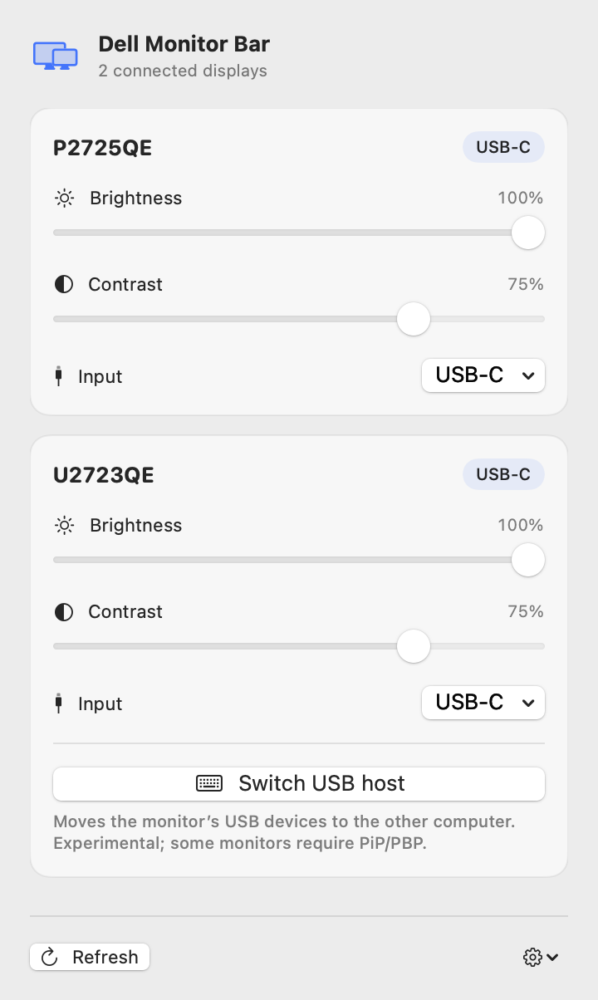

# Dell Monitor Bar

A small, native macOS menu-bar app for controlling Dell monitors on Apple
Silicon. Hardware brightness, contrast, input selection, and an experimental
USB KVM switch. No Dell software, background helper, external CLI, or package
manager required at runtime.



## Install

Download `DellMonitorBar-arm64.zip` from
[Releases](https://github.com/kacper-serewis/dell-monitor-bar/releases), unzip it,
and move **Dell Monitor Bar.app** to Applications. Open it and click the two-screen
icon in the menu bar. There is no Dock icon.

Requires **Apple Silicon and macOS 13 or newer**. Builds are ad-hoc signed,
not Developer ID signed or notarized. macOS may require approval in System
Settings → Privacy & Security → Open Anyway for a downloaded build. You can
also build directly from the source below.

Turn on **DDC/CI** in each monitor's on-screen menu. Connect through USB-C,
DisplayPort, or a supported HDMI connection; DisplayLink adapters generally
cannot carry these commands. Accessibility and Screen Recording permissions
are not required.

## Controls

- Separate brightness and contrast sliders for each detected Dell monitor.
  Changes are sent when you finish dragging, then read back from the hardware.
  Sliders stay responsive during hardware I/O; newer adjustments replace queued
  values, and delayed replies never overwrite an active drag.
- An input menu populated from that monitor's advertised inputs. The P2725QE
  and U2723QE expose USB-C, DisplayPort and HDMI.
- **Switch USB host** on monitors advertising Dell's USB KVM control. The
  P2725QE does not advertise it, so it gets no KVM button.
- Refresh, automatic refresh after display changes/wake, and optional launch
  at login under the gear menu. Install in Applications before enabling it.

Display targeting uses the display UUID and its matching framebuffer/DCP
service. It does not rely on display numbering, the main display, or hardcoded
serial numbers. Identical models are supported as separate display UUIDs.

## Input switching and KVM

Selecting an input switches the video source. If the monitor has USB KVM,
configure the video-input-to-USB-upstream associations in its own **USB** menu
and connect the upstream USB cables to the relevant computers. This lets the
monitor route USB with input changes. The app does not rewrite those mappings.

The **Switch USB host** button sends Dell's `0xE7 = 0xFF00` action once. It
moves the monitor's USB devices—including an attached keyboard and mouse—to
another host. Some models only accept this action while PiP/PBP is enabled.
Enable those layouts using the monitor's menu if needed.

**KVM is experimental.** The protocol is documented by existing open-source
reverse-engineering work, but physical USB switching has not been validated on
the U2723QE with a second computer. The app reports “switch sent,” not a
verified active host: reading `0xE7` does not reveal USB ownership. It never
retries the toggle or infers ownership from unrelated USB hubs.

Switching video away can make the display disappear from this Mac. Switching
back may require the other computer or the monitor's buttons. The app cannot
control a display once its connection is unavailable.

## Build

Install Xcode Command Line Tools, with Swift 5.9 or newer:

```sh
git clone https://github.com/kacper-serewis/dell-monitor-bar.git
cd dell-monitor-bar
swift test
./scripts/build.sh
open "dist/Dell Monitor Bar.app"
```

The build script produces an ad-hoc signed ARM64 app bundle. There are no
external Swift packages. GitHub Actions runs the protocol tests and uploads
a zipped app build.

Read-only hardware diagnostics:

```sh
"dist/Dell Monitor Bar.app/Contents/MacOS/DellMonitorBar" --diagnose
```

Explicit hardware write test (changes brightness by one raw unit, checks it,
and restores the original on each display):

```sh
"dist/Dell Monitor Bar.app/Contents/MacOS/DellMonitorBar" --verify-brightness
```

Render the panel offscreen with live monitor readings, without capturing the
desktop:

```sh
"dist/Dell Monitor Bar.app/Contents/MacOS/DellMonitorBar" --render-preview /tmp/panel.png
```

## Validation and limitations

Tested on an Apple M5 Pro running macOS 27.2 with a **P2725QE** and **U2723QE**:

- Both discovered and individually matched to their DDC services.
- Capabilities, brightness, contrast and current input read successfully.
- Both passed a brightness **100 → 99 → 100** test through this app's backend.
- Protocol tests cover checksums, truncation, wrong-code replies, capability
  paging, 16-bit vendor capability values, unadvertised inputs, readback,
  read retries, and ensuring KVM actions are sent only once.
- The panel was rendered and visually inspected. Full interactive UI testing,
  switching to another video source, physical USB KVM switching, launch at
  login, and unplug/sleep/wake behavior have not been validated end to end.

The project uses Apple's private `IOAVService` and CoreDisplay interfaces.
macOS updates can affect compatibility. Intel Macs, software dimming, keyboard
brightness shortcuts, network KVM, PiP/PBP layout configuration, and firmware
updates are outside the current scope. No telemetry or network access is used.

## Implementation

- `Sources/DDCBridge`: Objective-C IOKit discovery and raw transport. Every
  external display is matched to its own framebuffer; all retained IOKit/CF
  objects are released. Unsupported/virtual displays are excluded.
- `Sources/MonitorCore`: validated MCCS framing, capability parsing, and
  command policy. Read requests are duplicated by the transport. Absolute
  settings use two identical writes because a single brightness SET was ignored
  on the U2723QE. Action registers use one write with no automatic retry.
- `Sources/DellMonitorBar`: SwiftUI menu-bar panel, serialized background
  hardware access, diagnostics, and login-item integration.

Inspired by [m1ddc](https://github.com/waydabber/m1ddc) and
[delldisplay](https://github.com/tatimblin/delldisplay). See
[THIRD_PARTY_NOTICES.md](THIRD_PARTY_NOTICES.md) for attribution.

MIT licensed. Not affiliated with Dell. No Dell binaries or installer assets
are included.
